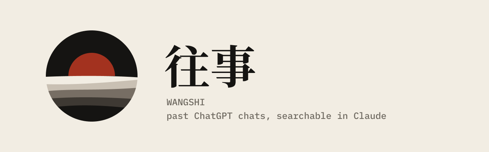
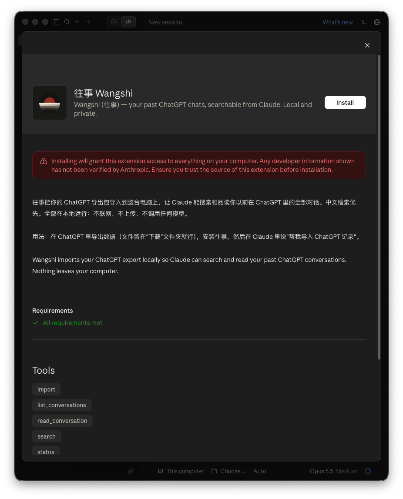
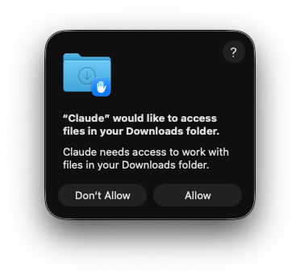
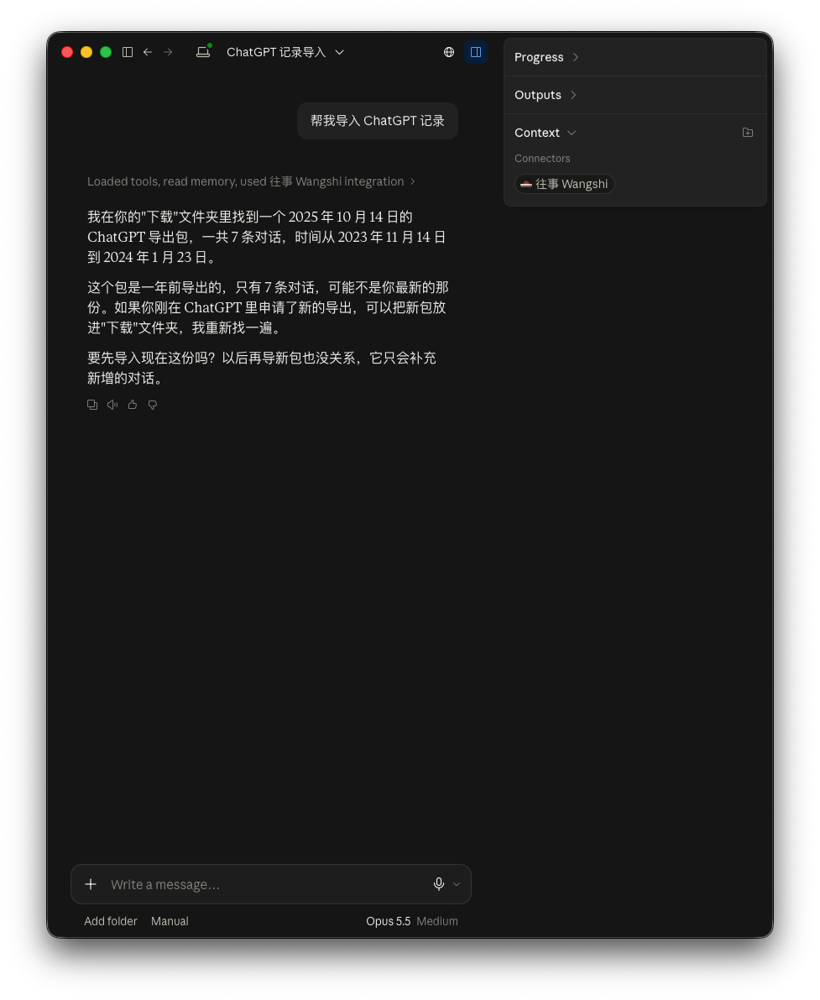
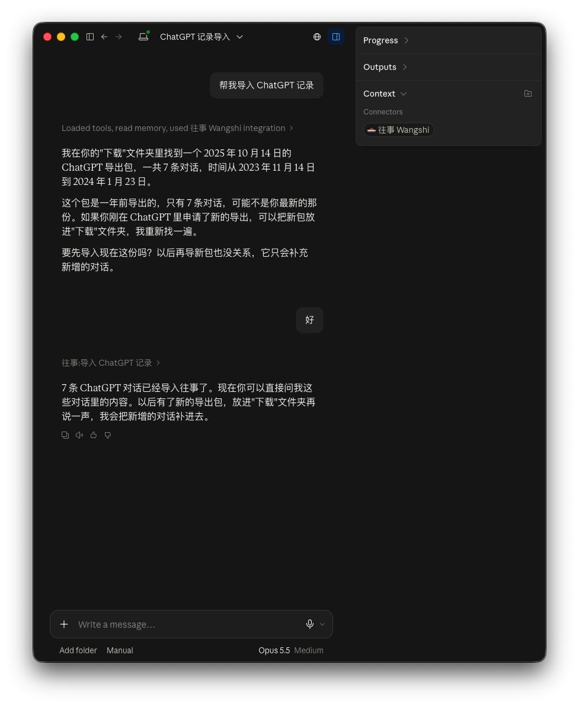
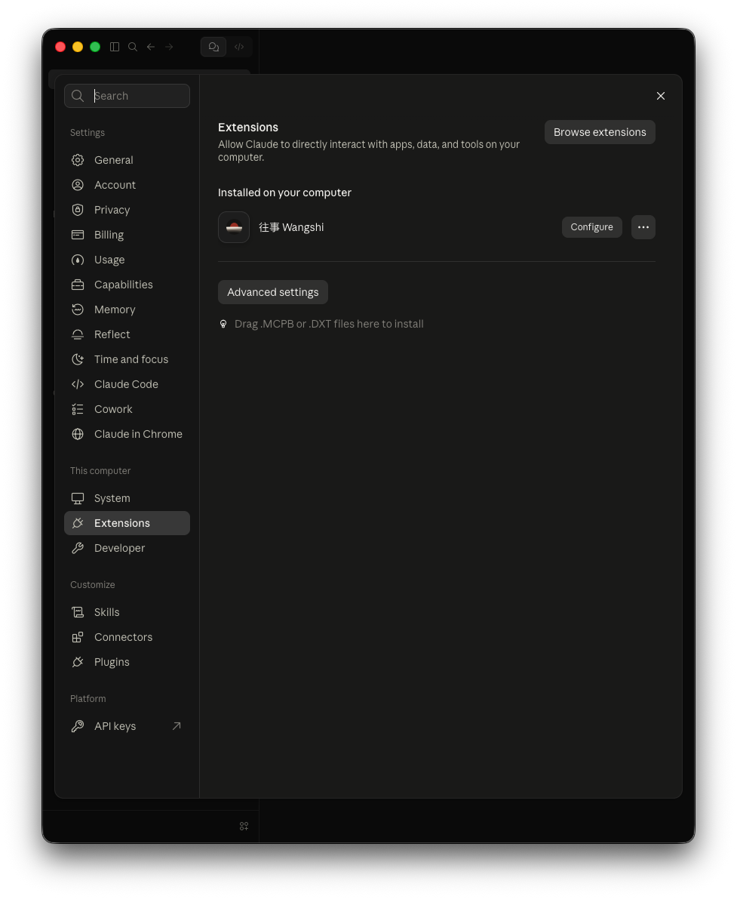
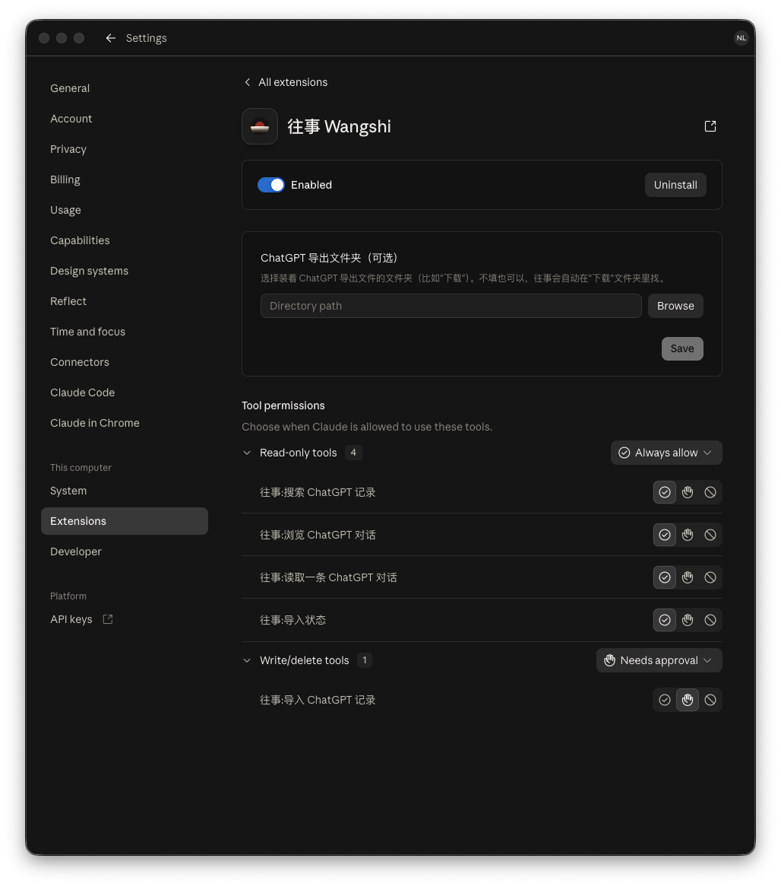
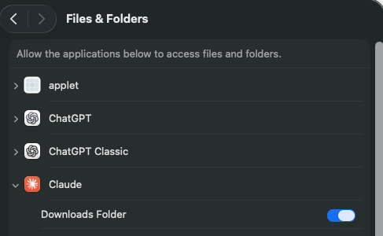

# 往事 Wangshi

**把你以前在 ChatGPT 里的全部对话，交给 Claude 来搜索和阅读。全部在你自己的电脑上完成。**

## 三步装好

1. **在 ChatGPT 里导出数据**
   打开 ChatGPT → 设置 → 数据控制 → 导出数据。几分钟到几小时后会收到一封邮件，点里面的链接下载。下载好的文件**留在"下载"文件夹里就行，不用解压**（Safari 自动解压了也没关系）。

2. **安装往事**
   在 [Releases](https://github.com/neallili/wangshi/releases) 下载最新的 `wangshi-x.y.z.mcpb`，双击，在 Claude 弹出的窗口里点 **Install**。

   安装时 Claude 会提示 "Any developer information shown has not been verified by Anthropic"（开发者信息未经 Anthropic 验证）——所有非官方扩展都会这样。往事开源，代码都在本仓库，不联网、不上传。

   

3. **在 Claude 里说一句："帮我导入 ChatGPT 记录"**
   第一次去"下载"文件夹找导出包时，macOS 会问 "Claude" would like to access files in your Downloads folder，点 **Allow**。

   

   导入每次都会弹出审批（Claude wants to use 往事:导入 ChatGPT 记录），点 **Allow once** 或 **Allow for this task**。Claude 找到导出包后会告诉你是哪天的导出、共多少条对话，问你要不要导入：

   

   回答"好"就行。导入一般只要几秒到一两分钟：

   

之后就可以直接问，比如："我以前在 ChatGPT 里问过怎么养多肉吗？""我去年问 GPT 的那个旅行计划，最后定的是哪里？"

---

## 第一次用之前，建议做的两件事

### 1. 把只读工具设成"总是允许"

默认情况下，Claude 每次搜索都会先问你"是否允许"。搜索、浏览、阅读这些工具只读取你本机的数据，可以放心地设成总是允许。

打开 Claude 的 Settings → **Extensions**，在往事 Wangshi 旁边点 **Configure**：

在 **Tool permissions** 里，把 **Read-only tools** 改成 **Always allow**。"导入"在 **Write/delete tools** 里，它会写入数据，建议保持 **Needs approval**。这一页上方的"ChatGPT 导出文件夹（可选）"（**Browse** / **Save**）一般不用填，见下面的常见问题。

### 2. 允许 Claude 访问"下载"文件夹

就是第 3 步里 macOS 的那个弹窗：点 **Allow**。如果不小心点了 **Don't Allow**，见下面的常见问题。

---

## 常见问题

**往事说找不到导出包，或者没有权限访问"下载"文件夹？**
- 没有权限（弹窗里点了 Don't Allow）：打开 系统设置 → 隐私与安全性 → 文件和文件夹（System Settings → Privacy & Security → Files & Folders），在 **Claude** 下面把 **Downloads Folder** 打开，然后在 Claude 里再说一次"帮我导入 ChatGPT 记录"。

  

- 导出包不在"下载"文件夹里：在往事的 Configure 页（上面第二张设置截图），点"ChatGPT 导出文件夹（可选）"旁边的 **Browse**，选择装着 ChatGPT 导出文件的文件夹，然后**一定要点 Save**。不填的话，往事会自动去"下载"文件夹里找。

**ChatGPT 里又聊了新的，怎么更新？**
重新导出一次，新文件留在"下载"文件夹，再跟 Claude 说"帮我导入 ChatGPT 记录"。只会补充新的和有变化的对话，之前的不会丢。

**手机上能用吗？**
可以，但要通过电脑上的 Claude 中转：**电脑要开着、不能睡眠，Claude 桌面版要在运行**。然后在手机的 Claude 里像平时一样问就行。

**Claude 说找不到往事的工具 / 手机上连不上？**
先在电脑上按 **⌘Q 完全退出 Claude**（只关窗口不算），再重新打开。大多数连接问题这样就能恢复。

**搜不到我记得聊过的内容？**
往事按关键词搜索，不理解同义词。换个说法、换成英文或中文、或者只用一个最关键的词再搜一次，通常就能找到。Claude 一般也会自己多试几次。

**怎么删掉往事保存的数据？**
往事的数据都在你主目录下的 `.wangshi` 文件夹里。在 设置 → 扩展 里卸载往事，再删掉这个文件夹即可。你的 ChatGPT 导出包不会被修改或删除。

---

## 隐私

- **数据只在你的电脑上。** 往事把对话存在你主目录下的 `.wangshi` 文件夹里，不联网、不上传、不调用任何 AI 模型。代码里没有任何网络请求。
- 往事只**读取** ChatGPT 导出包，绝不修改它。
- 当你在 Claude 里提问时，Claude 搜到的对话片段会作为这次对话的内容发给 Claude，和你自己把文字粘贴给 Claude 一样。

## 说明

- 往事按现状提供（as is），**不保证答疑**。遇到问题请在 GitHub 提 [Issue](https://github.com/neallili/wangshi/issues)。
- 目前只支持 ChatGPT 的官方导出包（ChatGPT → 设置 → 数据控制 → 导出数据），不支持 Claude 自己的导出包。
- 在 macOS 上测试过；Windows 还没有测试。
- 需要 Claude 桌面版（使用它自带的 Node.js，不需要另外安装任何东西）。
- 开源协议：MIT。

---

## English

**Wangshi (往事) — your past ChatGPT chats, searchable from Claude. Local and private.**

Wangshi is a Claude Desktop extension that imports your official ChatGPT data export and lets Claude search and read all of your past ChatGPT conversations. Search is tuned for Chinese (word segmentation with `Intl.Segmenter` + SQLite FTS5) and works for English too.

1. In ChatGPT, go to Settings → Data Controls → Export data, and download the file from the email. Leave it in your Downloads folder — no need to unzip.
2. Download the latest `wangshi-x.y.z.mcpb` from [Releases](https://github.com/neallili/wangshi/releases), double-click it and click **Install**. Claude will warn that "any developer information shown has not been verified by Anthropic" — every non-official extension shows this. Wangshi is open source: all of its code is in this repository, and it makes no network requests and uploads nothing.
3. In Claude, say "Import my ChatGPT history" (or "帮我导入 ChatGPT 记录"). Allow access to the Downloads folder if macOS asks. Importing asks for approval each time — click **Allow once** or **Allow for this task** — then confirm.

Everything stays on your computer: conversations are stored in `~/.wangshi`, the extension makes no network requests and calls no models, and your export file is never modified. Provided as is, without support; please report problems as GitHub issues. MIT licensed.
